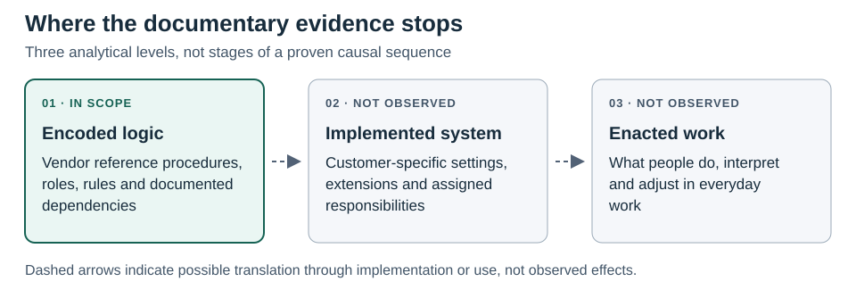

# Figure 1. The evidence boundary

**Caption.** The arrows mark possible translation, not an observed or inevitable sequence. The three analytical levels distinguish what reference documentation represents from what a customer configures and what participants do.

**Provenance.** Researcher-created conceptual illustration for Paper 1, 10 November 2026. It adapts the level distinction in the [conceptual framework](../02_Conceptual_Framework.md) and makes no empirical claim.
