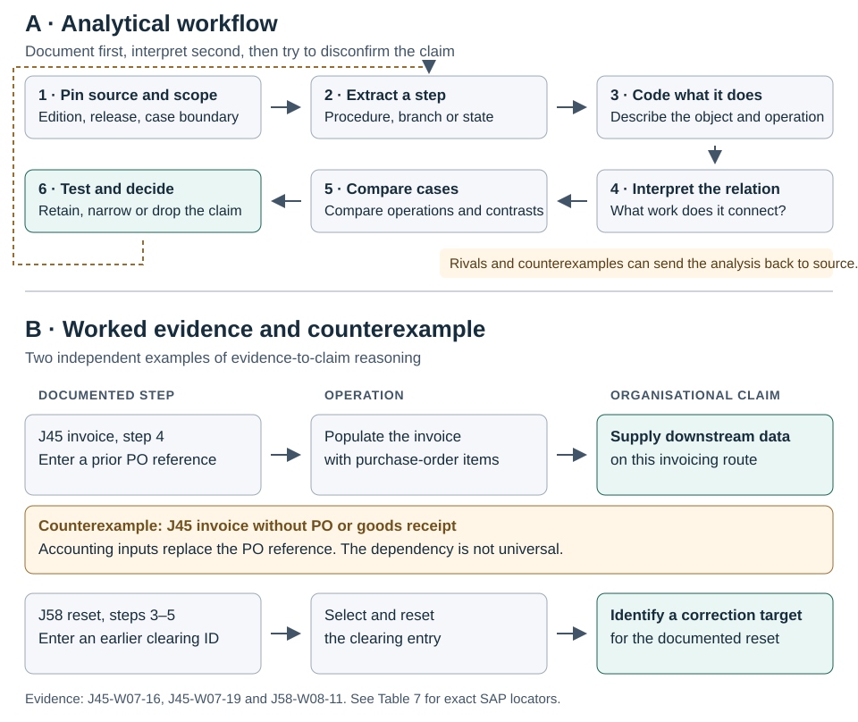

# Figure 3. Analytical framework



**Provenance.** Original analytical illustration for Paper 1, 10 November 2026. Panel A summarises the [analytical framework](../09_Analytical_Framework.md) and [paper method](../paper/04_Method_Draft.md). Panel B paraphrases the cited SAP steps and separates operation, organisational interpretation and limit. The graphic does not reproduce an SAP diagram.

**Panel A.** Pin the source and scope; extract an exact step, branch or state; describe the operation; interpret its organisational relation; compare cases; and test rivals and negative cases before retaining, narrowing or dropping a claim. A failed test can prompt a return to the source.

**Panel B. Text equivalent**

```text
SAP procedure                       Operation                   Organisational relation
────────────────────────────────    ─────────────────────────   ──────────────────────────────────
Invoice uses a purchase-order ID →  Populate invoice items   →  Later task uses earlier data
Clearing reset uses a prior ID   →  Select the clearing entry →  Later task targets an existing state

Contrast to the first row: an invoice can use accounting inputs without a PO.
Conclusion: the PO dependency belongs to the documented route, not to every invoice.
```

The two rows are independent examples, not a chain joining the cases. The non-PO invoice contrasts with the first row only. Sources: J45-W07-16, J45-W07-19 and J58-W08-11; see [Table 7](Table_07_Findings_Source_Locators.md).
