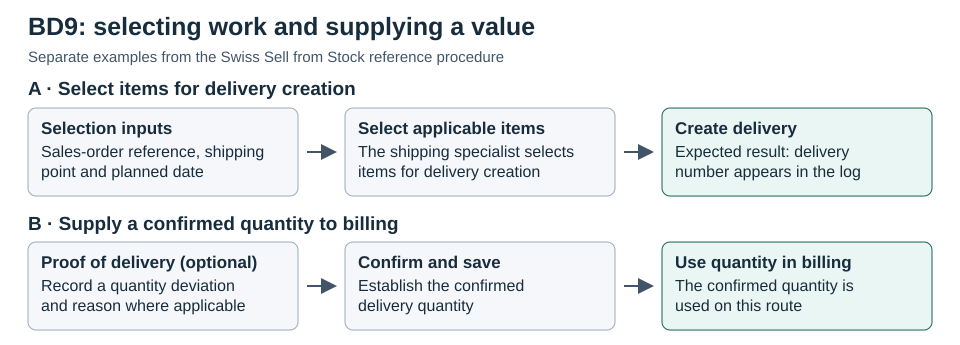

# Figure 4. BD9: selecting work and supplying a value

**Caption.** The sales-order reference, shipping point and planned date help select items for delivery creation (A). In the optional proof-of-delivery procedure, a confirmed delivery quantity supplies data used in billing (B). Selection defines which work can proceed in the illustrated step; supplying a value shapes what the later activity uses. The two examples do not trace one order.

**Text equivalent.**

- A. The shipping specialist uses the sales-order reference, shipping point and planned date to select applicable items. The documented expected result is a delivery number in the log, not evidence of physical fulfilment.
- B. On the optional route, the shipping specialist records a quantity deviation and reason where applicable, then confirms and saves. The confirmed quantity is used in billing on this route, not necessarily on every route.

**Provenance.** Original reconstruction of the Swiss BD9 reference procedure. Panel A: BD9-W08-08, DEL 1–5. Panel B: BD9-W08-12, POD 3–8. See [Table 7](Table_07_Findings_Source_Locators.md) for release-controlled SAP locators. No customer transaction was observed.
