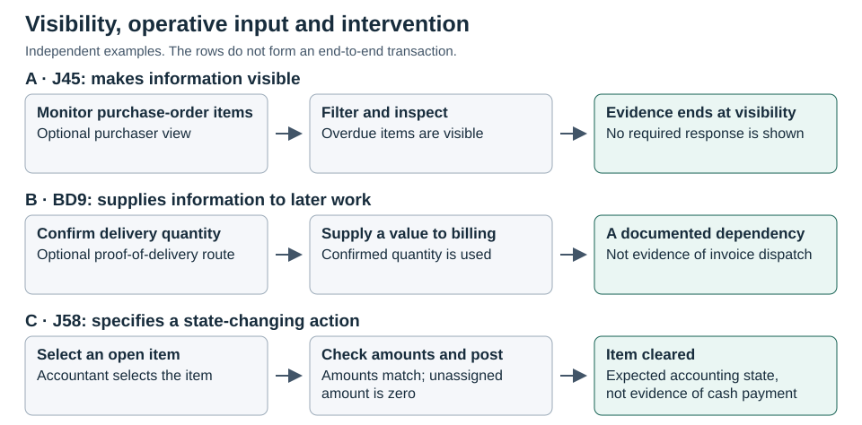

# Figure 6. Visibility, operative input and intervention

**Caption.** A J45 monitor makes overdue items visible without showing a compulsory response (A). The optional BD9 proof-of-delivery route supplies a confirmed quantity to billing (B). In J58 manual clearing, the accountant checks that the amounts match and the unassigned amount is zero before posting with clearing (C). Visibility, use of data, and a specified state-changing action are different documentary claims. The panels are independent and do not trace a single transaction.

**Text equivalent.**

- A. A purchaser filters and inspects purchase-order items. The reference identifies overdue items as visible but does not specify a mandatory response.
- B. A confirmed delivery quantity is used in billing on the optional proof-of-delivery route. This does not establish that the invoice was dispatched.
- C. An accountant selects an open item on an open-item-managed account, checks the matching condition, and posts with clearing. The expected result is an accounting state, not proof of payment or control effectiveness.

**Provenance.** Original comparison of the Swiss reference procedures. Panel A: J45-W07-22, MON 2–5 and the OV monitor row. Panel B: BD9-W08-12, POD 3–8. Panel C: J58-W08-10, MAN prerequisites and steps 3–7. See [Table 7](Table_07_Findings_Source_Locators.md) for release-controlled SAP locators.
