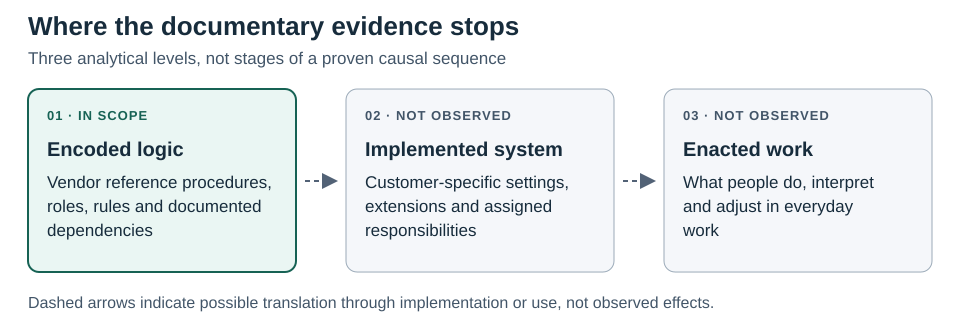

# Theoretical framework

## Reference architecture is an object of analysis

Enterprise packages offer common data and process structures, but neither their configuration nor their effects are determined by the vendor design. Research on tailoring and package misfit shows that an available feature may be missing a local requirement or may introduce a role, procedure or control that the adopting organisation does not want (Brehm, Heinzl and Markus, 2001; [Strong and Volkoff, 2010](https://aisel.aisnet.org/misq/vol34/iss4/8/)). Research on use shows why even a configured arrangement does not settle what people do with it (Boudreau and Robey, 2005; Orlikowski, 2000).

*Encoded organisational logic* means the arrangement of work represented or made available in the reference architecture. A documented instruction is evidence that a reference procedure represents an action. It is not, without further evidence, proof of executable enforcement. Architectural coherence asks whether the parts of a specified reference path fit together. Implementation fit asks whether the customer-specific arrangement addresses local requirements. Enacted fit asks how the arrangement works in situated practice. These distinctions guide inference; they are not successive levels of maturity or evidence of realised benefit.

**Figure 1. The evidence boundary.** The documentary analysis examines represented arrangements. It does not follow them into a customer's implementation or into everyday work. The levels are analytical distinctions, not a sequence the study observed.

Reference architecture is used here in a narrower sense than the full technical architecture of an application. It denotes the documented arrangements through which a vendor reference design presents business objects, process paths, actors, conditions and outcomes for a defined scope. A workflow setup procedure, a transaction script and a scope description can each make part of that arrangement visible. They do not all provide evidence of the same strength. A scope description can indicate that a function belongs to an offering. A setup procedure can show a configurable rule. A transaction script can show how an actor is expected to act and which result is expected under the example's assumptions. None is a substitute for the others. Nor is an expected result equivalent to an independently reproduced system behaviour.

A package's reference procedures can therefore be both consequential and incomplete as evidence. Davenport (1998) draws attention to the organisational logic of standard packages, while Soh, Kien and Tay-Yap (2000) explain why a package logic can conflict with local requirements. Brehm, Heinzl and Markus (2001) clarify that there are different ways of tailoring a package. These arguments are complementary rather than contradictory. An offered arrangement is not neutral because choosing it can bring particular dependencies or decision requirements into a design. It is not determinative because the relevant choices, permissible changes and subsequent use are not fixed by the reference alone. Strong and Volkoff's (2010) treatment of misfit gives this distinction practical force: a system can provide the requested function and still offer an unsuitable role allocation or control. Describing what a feature does without describing who depends on it and under what conditions can therefore miss the very aspect that needs to fit.

The three fit questions separate different objects of judgement. An analyst assessing architectural coherence examines a specified relation, such as whether the record created by one documented step provides what a later step expects. An implementation study asks whether that dependency should be preserved, adapted or avoided given the organisation's activities and constraints. An enactment study asks how participants actually supply, use or work around the information. The third question remains open even when the first two receive favourable answers. Conversely, people may find a workable way to coordinate even when the documented or configured arrangement is incomplete. These distinctions do not rank the quality of organisations. They specify what has to be observed before a claim about fit can be made.

Process and routine research explain why this boundary is substantive. Process architecture concerns relationships among representations of processes, not a history of individual transactions (Dijkman, Vanderfeesten and Reijers, 2016). A procedure can serve as a resource that participants draw on, but its presence does not show how they understand their routine or how they perform it in specific situations. Feldman and Pentland (2003) distinguish the ostensive and performative aspects of routines; an artefact that describes a sequence should not be equated with either the participants' understanding of it or their situated performance. Orlikowski (2000) and Boudreau and Robey (2005) likewise direct attention to use. Bracketing use here is a decision about what the sources can support, not a claim that material arrangements and practices are independent in an operating organisation.

## Dependencies, coordination and information

Thompson (1967) distinguishes pooled, sequential and reciprocal interdependence. These terms describe relationships, not features. Sequential dependence requires an identifiable input or state from an earlier activity; chronology alone is insufficient. Pooled dependence requires reliance on a common resource or contribution to a common whole; co-location in a platform is not enough. Reciprocal dependence requires mutual contingency between activities. A return for correction does not, by itself, show such an exchange.

Mintzberg (1979) addresses how differentiated work is coordinated, including by standardisation, supervision and mutual adjustment. The same dependency can be managed by different means, and a procedure can combine several. [Malone and Crowston (1994)](https://crowston.syr.edu/sites/default/files/acmcs94.pdf) connect the classification of a dependency to the mechanism that addresses it. In an architectural analysis, this requires identifying what the later task takes from the earlier one. A reference that supplies data is not equivalent to an identifier that selects the object of an action, even though both can make the relationship operative.

Galbraith (1973, 1977) relates design to information-processing demands under uncertainty. A system can represent capacity to make records visible, provide an input or draw attention to an exception. These are not equivalent to understanding or use. Okhuysen and Bechky (2009) distinguish coordinating mechanisms from conditions such as predictability and common understanding that mechanisms may help create. This distinction prevents the appearance of a schedule or dashboard from becoming a claim about the quality of coordination.

### Read the dependency before classifying the mechanism

An enterprise process can be represented as a chain of documents, but the documents matter for different reasons. To identify a sequential dependence, specify the upstream and downstream activities, the object or state joining them, and the effect of that connection. If an earlier record provides quantity to a later activity, the quantity is an operative input. If the later activity takes a document number to identify a target, the number can be necessary to direct the action even when no line data are copied. Both relationships can be sequential, but they are not interchangeable. The first concerns the provision of information used in later work; the second concerns the identification of what later work is to act upon. A document number displayed only for reference might establish neither relation. This is the point at which a theory of dependency becomes a discriminating test rather than a label for any cross-functional sequence.

The same discipline applies to the other forms of dependence. A shared organisational category may help several activities produce comparable records, but the analyst must identify the common resource or common whole on which they rely before describing the relationship as pooled. An exception returned to its originator may make a reciprocal relation possible. To establish such a relation at the documentary level, there would have to be evidence of a specified exchange in which the parties' actions condition one another, not just a handoff in the opposite direction. Even if that exchange is documented, it would establish a formal arrangement, not observed mutual adjustment. Thompson's (1967) forms of dependence and Mintzberg's (1979) coordinating mechanisms answer different questions. The former characterise the relation; the latter concern how it is managed. The same formal return may be structured by standardised steps while leaving room for adjustment in practice. Evidence of one should not substitute for evidence of the other.

Standardisation itself needs an object. A procedure can standardise the order of actions, a matching rule can specify a criterion for acceptable input, and a common format can standardise the information an activity produces. These are distinct even when they coexist. For example, a documented check before a posting describes the expected order of work; a stated condition that must be satisfied describes a control within that work; an identifier retained after posting offers a way to trace the result. In a dependency-centred analysis (Malone and Crowston, 1994), the point is to connect each mechanism to the problem it addresses. It is possible to describe all three as coordination aids, but doing so without distinguishing their operations would make the category too broad to explain anything.

### Information processing and the difference between availability and use

From an information-processing perspective, representing a condition, supplying data and applying a criterion have different implications. A monitoring view makes something available for attention. A populated field can enter the next task even if the user does not separately retrieve its source. A matching rule specifies how a value is evaluated for a particular action. The first increases what the design makes inspectable; the second identifies an information dependency; the third can constrain execution. Galbraith's (1973, 1977) question about the fit between information requirements and processing capacity makes the contrast relevant. It does not allow the analyst to assume that an organisation's information needs are met because a view or data flow exists. An overdue item can be visible and still have no documented intervention associated with it. A value can be carried across a handoff without establishing that it is correct or that people understand it in the same way.

Classification helps explain how these operations can recur. Common names, identifiers and organisational fields allow different activities to refer to the same business object or to select a consistent scope. Yet a category is not simply a neutral label (Bowker and Star, 1999). It makes certain distinctions available for subsequent work and leaves others outside the represented scope. A company code may have significance for an accounting operation, while a shipping point can delimit delivery selection. Whether either also constrains access is a separate question. The relevant inference concerns how the field is used in the particular procedure, not whether a named category exists in the common architecture. Similarly, the conditions identified by Okhuysen and Bechky (2009) can clarify why an arrangement might matter, but their actual presence should not be deduced from the availability of a coordinating device.

## Decisions, access and control

Decision premises are facts, criteria or constraints that structure what is considered and how choices are made (Simon, 1947/1997; March and Simon, 1958/1993). Software may use such premises to route a task. That operation is distinct from the recipient's represented decision, and both are distinct from any resulting state change. In the analysis, the order in which workflow definitions are checked is therefore not evidence that two people approve the same object in sequence.

Technical access concerns what an actor is permitted to do under specified settings. Formal authority is the right to decide, while real authority is effective control over the decision ([Aghion and Tirole, 1997](https://www.journals.uchicago.edu/doi/10.1086/262063)). A routing recipient, a task-selection field and a configured permission are separate pieces of evidence. A rule may control work when a stated standard is applied to an object and a consequence follows (Ouchi, 1979; Eisenhardt, 1985). Information made available for inspection is a different matter. Similarly, traceability can support accountability without establishing the obligation to answer to a forum or the possibility of judgement and consequences ([Bovens, 2007](https://onlinelibrary.wiley.com/doi/10.1111/j.1468-0386.2007.00378.x)).

Bounded rationality supplies a reason to examine the premises rather than merely the recorded outcome. A choice occurs within an environment that makes some facts, criteria and alternatives more salient than others. Simon (1947/1997) and March and Simon (1958/1993) thus make it possible to ask how a rule or representation shapes the work of deciding. In a reference procedure, conditions may route a case to a recipient; the recipient may be given more than one action; and a subsequent operation may implement the chosen action. All three can be specified without establishing how any particular person formed a judgement. It is analytically useful to ask which premises are encoded at setup, which are supplied when the transaction occurs, and which questions remain for a person to resolve. A condition configured in advance and an exception resolved during execution represent different points of discretion.

Decision authority and discretion should not be inferred from the availability of alternatives. An example showing a recipient's approval option is evidence of the decision represented in that procedure. It does not establish that the recipient is the ultimate organisational authority or that formal and real authority coincide. Aghion and Tirole (1997) distinguish these forms of authority; the distinction is especially useful when software offers several layers of allocation. A role template can define a class of intended users, a workflow can designate a recipient, and an authorisation rule can condition who may carry out a system action. Each can be examined in its own right. Whether all three align in a given organisation requires configuration evidence; whether the person with access actually determines the outcome requires evidence about practice.

Control and accountability require parallel care. To reconstruct a control, ask what is checked, against which criterion, and what the documented consequence is. To reconstruct accountability, ask who must explain what to whom, and what the forum can do with that explanation. The source may support only part of either relation. A log can make a decision reconstructable, a mandatory criterion can condition a transition, and a return reason can inform a correction. The first is not proof of answerability, the second is not proof of effectiveness, and the third is not proof of reciprocal negotiation. Ouchi (1979), Eisenhardt (1985) and Bovens (2007) are useful together precisely because they do not reduce these different questions to the existence of a rule or an audit trail.

### Where to locate discretion

The term discretion is especially easy to overextend because the same reference design can offer choice at several levels. The configuration role may choose among supported conditions or decide which arrangement to activate. A transaction role may choose a permitted response to a case. A reviewer may interpret an exception and decide whether more information is needed. These choices differ in their objects and timing: one shapes the premises for later decisions, another applies them to an individual case, and another can send work back for reconsideration. Their documentary traces differ too. Setup instructions can establish a configurable choice; a procedure can establish that a response is offered; neither shows how a customer assigned the corresponding responsibility or how a person exercised it.

This is why automation need not be opposed to discretion in the abstract. A scheduled operation may remove the need to initiate every instance manually while leaving decisions about parameters, scope and exception response elsewhere. A fixed check can constrain one route without determining what is done after an exception is found. The appropriate question is which part of the decision or execution is specified, and what remains conditional on another action or actor. To treat automation as a transfer of authority would require evidence that the relevant choice has actually moved, not simply that the system carries out an operation after a condition is met. This distinction follows from separating decision premises, actions and consequences rather than assuming that all work performed by software constitutes judgement.

## What qualifies as an organisational operation

A *software organisational primitive* is a candidate reusable operation that can be identified in relation to differentiated work. It qualifies analytically when the evidence identifies the operation, the object or actor it concerns, and the condition or consequence that makes it organisationally relevant. A routing operation and the decision nested within it can be distinct without counting as independent replications. An application name or a status shown only for display is insufficient.

**Figure 2. Theoretical framework.** The analysis starts with a dependency and identifies an operation in that relation. The three lenses ask how work is connected, what information becomes available or is used, and how choice or action is structured. They are complementary perspectives, not stages in a process.

Candidate primitives are therefore comparison devices, not claims about the indivisible parts of software. Two records can use the same document-reference function but organise different work. Conversely, different technical implementations might support a comparable organisational operation. The criterion is not identity at the interface level. It is whether there is a sufficiently precise, evidence-supported relation between an operation, its conditions and a task or object. For instance, selecting which object an action will affect is a plausible candidate for comparison across domains. It should not be bundled with the effect of that action, and it is not evidence of an allocation of authority merely because the selection occurs in a controlled application.

A single route can combine several such operations. A workflow may classify a case, route it to a role, make contextual information available, record a choice and change a state. Decomposing these operations makes clear what an alternative route omits or substitutes. It does not imply that the operations are independent when the same procedure supplies their evidence. The theoretical expectation is correspondingly modest: comparative analysis should be able to identify recurrent forms of connection and difference without inferring either universal primitives or recurring organisational outcomes. The strongest contrasts will often come from apparently similar paths whose prerequisites or effects differ.

There are two implications for what would count against the framework. A route that reaches the same result without the proposed dependency shows that the dependency is not necessary for that result in general. It does not establish that the dependency is irrelevant on the original route. A second case in which an apparently equivalent feature does different work is a different kind of challenge: it shows that the feature is too coarse a unit for comparison. The appropriate response is to narrow the first claim and reconsider the category in the second. Together these tests make it possible to distinguish a conditional mechanism from a misleading analogy. They also guard against building a theory out of familiar labels and using the same labels as the evidence for it.

The unit of explanation is the arrangement, not the primitive alone. The analysis asks what one activity needs from another, how a rule, reference or schedule manages that relation, and where the same feature does different work. It then tests the interpretation against alternatives. A shared classification may be a prerequisite for distributed work, but that use must be shown rather than assumed from the existence of master data (Bowker and Star, 1999). A process reference or test script is a selective artefact, not a trace of a transaction or a performed routine (Feldman and Pentland, 2003; Dijkman, Vanderfeesten and Reijers, 2016). The comparison consequently concerns represented organisation design, not an account of how an organisation actually works.

