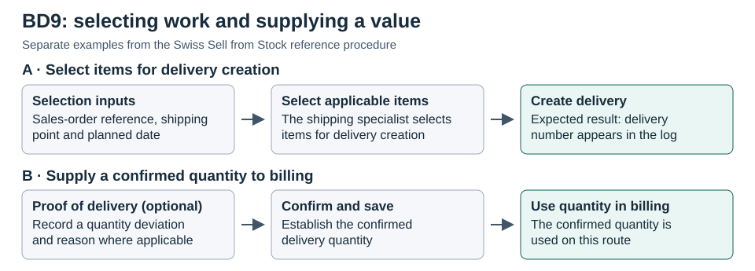
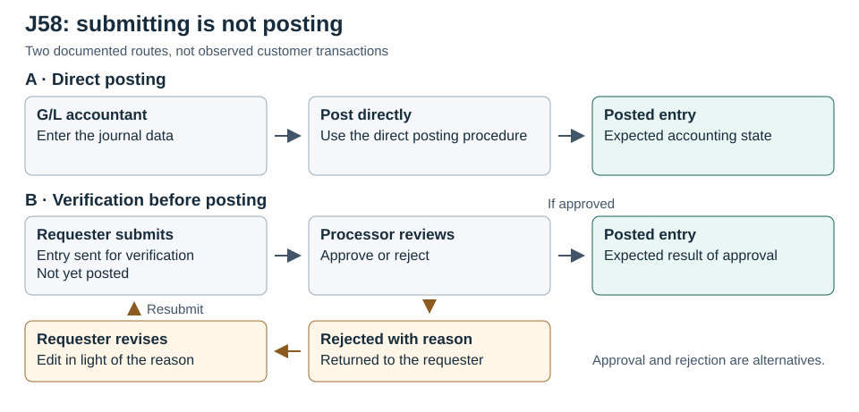
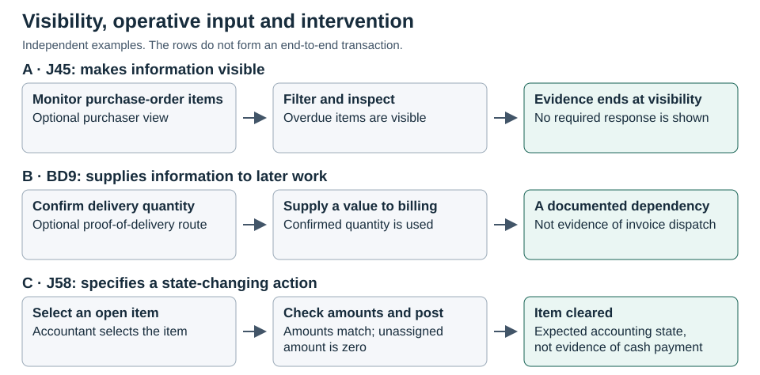

# Findings

Three contrasts organise the findings. The first concerns the work a record performs when one activity depends on another. The second concerns the difference between selecting a decision route, taking a decision and changing the state of an object. The third concerns the difference between making work visible and intervening in it. Each contrast starts with the documented operation and then considers what it explains about the arrangement of work. The comparison uses counterexamples within cases as well as recurrent operations across them. A reference path can therefore be informative precisely because an alternative reaches a similar result without the same dependency.

## Records connect activities in different ways

In the referenced J45 invoicing route, the accountant enters an earlier purchase order and its items populate the invoice. The purchase order therefore provides more than an identifier for navigation: its content is used by a later activity. In the alternative invoice route, the accountant enters general-ledger, cost-centre and tax information without a purchase order or goods receipt. That branch still has consistency checks, but it is not coordinated through the same record dependency. The contrast rules out a universal purchase-order prerequisite and does not establish that a three-way match is enforced in all cases (J45-W07-16, J45-W07-19).

The referenced invoice procedure is revealing because the reference does not complete the accountant's work. The accountant enters the earlier purchase order, inspects the proposed items, checks amounts, quantities and taxes, and checks the balance before simulating and posting. The documented transfer makes earlier purchasing data available as part of the later task. It does not determine that the claim is correct or remove the checking responsibility. If the reference were merely displayed, an analyst could establish traceability but not the same role for the upstream data in preparing the invoice. Here it is the population of items, not the visibility of the number, that supports the dependency interpretation (J45-W07-16).

The no-reference route does not imply an absence of coordination. It shows a different basis for organising the same broad accounting activity. The accountant supplies accounting items and assignments rather than using the PO to populate them, and consistency and tolerance checks still precede posting. The alternative therefore qualifies two propositions at once. A purchasing record is not a universal prerequisite, and the absence of the purchasing reference does not mean the absence of structured inputs or controls. The appropriate comparison is between two documented routes that differ in what information they use, not between a controlled and an uncontrolled organisation (J45-W07-16, J45-W07-19).

In BD9, the shipping specialist uses a sales-order number, shipping point and planned date to select items for delivery creation. In the optional proof-of-delivery route, a different relation is visible: confirmed quantities are used in the following billing step. One operation selects work; the other supplies a value used downstream. In J58, the accountant identifies the earlier clearing entry by its number and company code to reset it. That number targets the state-changing action; the procedure does not describe a transfer of transaction items comparable to the J45 invoice. Taken together, the cases show a record or represented state making later work actionable, but through distinguishable operations: supplying data and identifying the object of action (BD9-W08-08, BD9-W08-12; J58-W08-11).

**[Figure 4. BD9: selecting work and supplying a value](../figures/Figure_04_BD9_Record_Handoffs.md).** The delivery procedure uses references and criteria to identify work; the optional proof-of-delivery procedure supplies a quantity for downstream use. The panels do not trace one order (BD9-W08-08, BD9-W08-12).

Figure 4 draws out a similar distinction within one sales scope. In the delivery creation procedure, the shipping specialist uses the prior sales document together with shipping context to delimit the work. The output that the script expects is a delivery and a number in its log. The number is evidence of the expected result of creating the document, not evidence that goods were delivered. In the optional proof-of-delivery procedure, by contrast, the operation confirms a quantity that the billing task uses. This is not merely another way of searching for a record. The confirmed quantity is part of the content supplied to a later task. Nor does this comparison establish that confirmation is a prerequisite for all billing. The optional procedure makes a particular dependency visible; its scope is part of the finding (BD9-W08-08, BD9-W08-12).

Financial close offers a useful further contrast. The J58 automatic clearing procedure describes the clearing of qualifying items and the generation of a clearing document. In the separate reset procedure, the prior clearing-document number and company code identify the earlier clearing entry to be reset. The task depends on a previous accounting state in the sense that the action needs the earlier clearing entry as its target. It is not documented as a second activity that imports purchasing or billing quantities from that record. It is also not a reversal of the underlying journal entry simply because the effect concerns an earlier posting. That would conflate a correction to a clearing arrangement with a different accounting operation (J58-W08-11).

Technical necessity and organisational significance need not be rivals in the sense that only one can be true. A reference can be technically required precisely because a later activity needs the output of earlier work. What makes the organisational interpretation defensible is the documented use of the reference, not the fact that one screen follows another. Scope fields matter in the same limited sense. J45 uses purchasing group in a workflow condition; BD9 uses shipping point in delivery selection; J58 uses company code in the verification setup. The fields scope selected operations. That is not evidence that they assign access in the same way, or that a reporting dimension is an organisational unit (J45-W07-06, J45-W07-23; BD9-W08-02, BD9-W08-08; J58-W08-04, J58-W08-06, J58-W08-16).

This comparison also clarifies what organisational fields contribute. A purchasing group can be a premise for whether a workflow condition is met. A shipping point and planned date can help select delivery work. Company code is used in the verification configuration and is part of the context of the separately documented forwarding check. These fields matter for different reasons even though each helps delimit an action. A value used to select a population for a report cannot be assumed to perform the same function as a workflow condition or an authorisation restriction. The common finding is narrower: selected operations apply to a delimited set of work, and the documented role of the field tells us what kind of delimitation is involved (J45-W07-06, J45-W07-23; BD9-W08-02, BD9-W08-08; J58-W08-04, J58-W08-06, J58-W08-16).

A second comparison concerns traceability without a transfer of control. J45's goods-receipt detail procedure presents the earlier purchase order and material document together and exposes dates and delivery-note information. This helps a reader reconstruct related records, but the procedure does not show that a particular reviewer has to inspect the relation or take a decision on it. By contrast, the earlier invoice procedure describes a use for data derived from a reference. The two examples show why even a well-documented connection between records should not automatically be described as a dependency of one task on another. It can instead be an opportunity to inspect a relationship after the event. It is the described use of the record that distinguishes the cases, not the presence of a navigable document chain (J45-W07-14, J45-W07-16).

## Routing, deciding and changing state are separate

The J45 approval material identifies conditions for routing a purchase-order release task and a represented recipient. The execution procedure describes approval of the order. The configuration and execution examples give different CHF amounts, so they support conditional routing but not a single threshold. The documentation also calls for an automatic-release workflow; the direct-order example does not show which release outcome that specific order reaches. The evidence therefore neither makes human approval universal nor establishes the precise fallback behaviour for a particular transaction (J45-W07-06, J45-W07-07, J45-W07-08, J45-W07-09).

The procurement comparison shows why it is necessary to read setup and execution together. The setup example describes conditions for when a workflow applies and identifies a represented recipient. The execution procedure shows the action of approval on a purchase order. These two records contribute different parts of the inference: the setup offers premises for routing, while the procedure gives the decision and object to which they relate. The amount in one procedure should not be substituted for the amount in the other, and the presence of an automatic-release option should not be used to invent an observed fallback for a particular order. The strongest supported conclusion is about conditional routing and the represented approval action, not a general threshold or an observed distribution of purchase orders between routes (J45-W07-06, J45-W07-09).

BD9's sales-order setup specifies two ordered workflow definitions with different recipient levels. Ordering definitions is not the same as requiring two successive approvals of one order. The execution procedure gives the Sales Manager release, rejection and request-for-rework options. A separate approval route concerns preliminary billing, a different object. Credit-block review is distinct again: BD9 refers the tester to BD6 for the detailed credit decision. A common label such as release cannot determine which decision is involved or establish how two gates interact in one live order (BD9-W08-03, BD9-W08-04, BD9-W08-05, BD9-W08-16).

In BD9 the word release applies to decisions with different targets. A release action on a sales order belongs to the represented sales approval workflow. A release decision concerning a preliminary billing document has its own setup and represented recipient. The credit-block branch directs the tester elsewhere for the detailed credit decision. The existence of these paths does not tell us how a given transaction would encounter all of them. In particular, the documented ordering of workflow definitions is an ordering at the configuration level. It provides no basis for converting recipient levels into a sequence of approvals on one order. The distinction matters because otherwise one could infer an escalation hierarchy where the record shows alternative definitions, or mistake a financial-risk decision for a decision about releasing a sales object in another workflow (BD9-W08-03, BD9-W08-05, BD9-W08-16).

J58 provides a sharper state contrast. In the verification branch, a submitted journal entry is not yet posted; the processor approval procedure expects approval and posting. A separately documented path posts a journal entry directly. The distinction is therefore between two documented arrangements, not between organisations that do and do not verify their entries. J58 also describes a company-code posting-authorisation check when forwarding to a new processor. That specific check is not replicated by the task fields or role templates in the other cases. General product documentation can distinguish the access layer from workflow routing, but it cannot show a common access allocation in the Swiss cases (J58-W08-01, J58-W08-04, J58-W08-05, J58-W08-06).

**[Figure 5. J58: submitting is not posting](../figures/Figure_05_J58_Journal_Posting.md).** The two documented routes allocate work differently before a journal entry is posted. The verification route adds a processor decision and a return path; the represented responsibilities do not establish actual segregation of duties (J58-W08-01, J58-W08-05, J58-W08-07).

As Figure 5 shows, the verification route adds work before the journal reaches a posted state. The requester submits, the processor receives a decision task, and the procedure expects posting after approval. The direct procedure reaches the same type of state through a different arrangement. These are separate examples, not evidence that a requester can choose to bypass a control in a customer configuration. Their comparative value lies in showing what the verification route adds: a state in which the entry exists but has not been posted, a recipient with a represented decision, and an action that changes the expected state. The same final label therefore conceals distinct paths of preparation and decision (J58-W08-01, J58-W08-04, J58-W08-05).

The forwarding procedure provides a more specific kind of governance evidence. It describes a posting-authorisation check on the new processor in the company-code context. That is stronger evidence of a permission-related operation than a role name or a field used to filter work. But it applies to the documented procedure and does not establish whether checks are enabled in a particular deployment, who has the relevant permissions there, or whether procurement and sales use equivalent checks. The comparison thus establishes a distinction between routing and access while failing to establish a common allocation of access across the cases. That negative finding matters: it prevents a recurrent pattern of scoped work from becoming a finding about the organisation-wide distribution of authority (J58-W08-06; J45-W07-23; BD9-W08-02).

A formal return can also be identified without assuming a full feedback cycle. J45 documents a rework request and an instruction to the creator, not completed creator-side rework. BD9 shows a response or edit route, and its separate withdrawal-and-change procedure can lead back to approval. J58 explicitly documents edit and resubmission after rejection. These are evidence of specified paths for returning work with a reason or instruction. Only the steps documented for each route support a claim about follow-through; none establishes negotiated adjustment between participants (J45-W07-10, J45-W07-11, J45-W07-12; BD9-W08-05, BD9-W08-06, BD9-W08-07; J58-W08-07).

The J45 invoice exceptions show the value of identifying the object and consequence before comparing a release action with an approval. The referenced invoice example allows an item-level manual payment block with a stated reason. In the separate release procedure, Accounts Payable selects a blocked invoice for release. That establishes a represented change in payment eligibility, not a second approval of the purchasing commitment or evidence that the invoice was then paid. The scripts are separate, so they do not show that the same item was blocked and later released or that the people involved were independent. The documented choices nevertheless have different objects from purchase-order approval: they concern an invoice and its ability to proceed towards payment (J45-W07-17).

The invoice-reduction alternative separates another pair of operations that can look like one exception resolution. The accountant can represent a difference between the supplier claim and the purchase-order values, then check, simulate and post in the illustrated procedure. The associated complaint letter is a distinct output that can be retrieved and printed. The reduction represents a response to the discrepancy in the transaction. The letter makes communication possible, but its availability does not establish dispatch, supplier acceptance or negotiation. These differences matter for both decision and coordination: recording how the organisation treats a discrepancy is not the same as demonstrating how two parties reach agreement about it (J45-W07-18).

There is a further difference between returning work and reversing what has already been done. J58 documents a rejection with a reason and a requester-side edit and resubmission. The loop in Figure 5 is therefore drawn only for that route. The J45 purchase-order procedure supports a claim that an instruction is sent back, but does not show completion of the creator-side response. BD9 offers responses to rework and separately describes withdrawal and change; the branches should not be fused into a single completed feedback cycle. In each case, the formal arrangements can be compared by asking who can return the object, what travels with it and where the documented sequence stops. They cannot be compared as observations of mutual adjustment. A correction channel is a represented possibility for organising feedback, not proof that people reached a shared judgement through it (J45-W07-10, J45-W07-11, J45-W07-12; BD9-W08-05, BD9-W08-06, BD9-W08-07; J58-W08-07).

## Execution, inspection and intervention are not interchangeable

In J45, a purchaser schedules conversion of requisitions to purchase orders and inspects the result. BD9 offers jobs for delivery creation and billing release, with a log available after execution. J58 distinguishes predefined year-end carryforward from an earlier scheduled alternative and distinguishes a test run from a productive run. The common scheduler explanation is plausible at the technical level. The organisational comparison concerns the specific work assigned to it, the timing or parameters set before execution, and the inspection opportunities documented afterwards. The cases do not show that a person schedules or reviews every run, that discretion is removed, or that efficiency improves (J45-W07-05; BD9-W08-17; J58-W08-12, J58-W08-14, J58-W08-15, J58-W08-17).

The scheduling examples are comparable without being instances of the same business operation. In J45 the represented task is conversion from requisition to order; scheduling does not replace the need for the task's documented inputs or make its output an observed commercial commitment. In BD9 the jobs concern delivery creation and billing release, respectively. A job log allows later inspection, but its availability does not show that an accountable reviewer inspected it or followed up. In J58, the distinction between a test and a productive run shows why a scheduled activity should not be equated with a state change. One procedure can prepare or test an operation without the same consequences as the productive alternative. The reference also distinguishes an earlier carryforward option from the predefined year-end arrangement. The comparison therefore concerns how timing, parameters and inspection are represented for particular tasks. It does not turn the shared use of a scheduler into a finding that automation eliminates discretion or reduces work (J45-W07-05; BD9-W08-17; J58-W08-12, J58-W08-17).

What a record makes visible is not necessarily what it causes. A J45 monitor exposes overdue items without demonstrating a compulsory response. A BD9 billing preview is not evidence of dispatch; confirmed delivery quantities, in the optional route, are a stronger example of information used in later work. In J58, the results view exposes validation details, whereas manual clearing specifies a matching condition and an expected cleared state. These contrasts distinguish inspection, operative input and documented intervention. They do not establish actual monitoring, answerability or control effectiveness (J45-W07-14, J45-W07-22; BD9-W08-12, BD9-W08-14; J58-W08-10, J58-W08-15).

Consider first the optional J45 monitor. It displays and filters items, and the scope overview indicates that overdue items can be identified. This creates a place to inspect the state of work. It does not document who must respond, a required escalation, or a system action that changes the overdue item. The distinction is not that viewing has no organisational relevance. A view can make a condition accessible to a purchaser. The point is that the available evidence stops at visibility. The same discipline applies to the J58 validation results: being able to inspect the details of a rule result is not, in the cited procedure, equivalent to the application of a posting block or to authorisation to close the accounts (J45-W07-22; J58-W08-14, J58-W08-15).

The BD9 quantity example goes one step further in evidential terms, not as a stage in a common process. The optional route documents the use of a value in billing. This supports a claim about an input to an operation; it does not support a claim that an invoice was issued to the customer. The separate billing-preview example is a useful contrast, since it distinguishes forms and states of an output without demonstrating dispatch. Inspecting a document and establishing how its content enters later work are therefore different observations even in one scope (BD9-W08-12, BD9-W08-14).

J58 manual clearing provides a third type of evidence. The procedure specifies an open-item-managed account and the selection of an item, requires the assigned and entered amounts to match with no unassigned amount, and directs the accountant to post with clearing. Here the evidence connects a criterion with a particular intervention and an expected accounting state. The criterion is not merely offered as information on a screen. It has a role in the documented operation. The result remains a reference expectation, not evidence of an actual clearing or a cash settlement. Figure 6 places these three independent examples alongside one another to show what each permits the analyst to say, without ranking them as successive steps or as stronger and weaker implementations of one control (J45-W07-22; BD9-W08-12; J58-W08-10).

**[Figure 6. Visibility, operative input and intervention](../figures/Figure_06_Visibility_Input_Intervention.md).** Each row has a different documented consequence: information can be inspected, it can be used in later work, or an action is specified that changes an accounting state. The rows do not form a single transaction and do not establish actual responses or outcomes (J45-W07-22, BD9-W08-12, J58-W08-10).

The validation and reporting material makes the same point at a different scale. In the balance validation example, the selected rule group and accounting context delimit the work of the job. The results procedure exposes individual rule details and lets the accountant reveal successful checks that are hidden in the default view. This distinction between the scope of the job and the scope of a view matters: a rule not initially displayed is not necessarily a rule that was not processed. Nor is a displayed result a sign-off. It is evidence that the reference procedure makes a particular set of results available for inspection. Without a documented connection between the result and another state transition, the analysis cannot turn the inspection step into a general control over posting or financial close (J58-W08-14, J58-W08-15).

The scheduling and visibility findings thus qualify one another. Scheduling says something about when and under what parameters work is expected to run; an inspection facility says something about what can be reviewed after it runs. Neither, by itself, says that a person is obliged to act on the result. Conversely, the manual clearing procedure does not require us to infer an intervention from the existence of a log: the source actually describes the criterion and action. The comparison depends on these differences in what the procedure specifies. It would be weaker if all references to a log, rule or action were coded as evidence of the same governance mechanism (BD9-W08-17; J58-W08-10, J58-W08-15, J58-W08-17).

## Scope of the comparison

J45 names outgoing payment under succeeding Accounts Payable scope J60. BD9 points to Accounts Receivable scope J59. J58 includes reporting and balance carryforward, but its records do not follow an identified J45 or BD9 transaction. The comparison therefore supports recurrence of particular arrangements across bounded procedures, not a demonstration that one transaction passed from order to settlement and close (J45-W07-24; BD9-W08-18; J58-W08-16, J58-W08-17).

The three scopes consequently support a comparison of represented arrangements rather than a reconstruction of the full transaction lifecycle. The links to succeeding scopes are valuable precisely because they identify where the present evidence ends. Integrating the cases analytically means using common questions about operations, dependencies and states. It does not mean joining their diagrams with arrows that imply a document was followed across them. The same limit applies to recurrence within a case. Two references to one procedure can support different descriptions of what it does, but they cannot be counted as independent evidence that the arrangement repeats. The result is a set of bounded comparisons whose strongest common claims concern specified dependencies, decision conditions and distinctions between inspection and action.

[Table 5](../figures/Table_05_Cross_Process_Mechanisms.md) compares the mechanisms and counterexamples. [Table 7](../figures/Table_07_Findings_Source_Locators.md) maps the evidence identifiers to public source locations.

